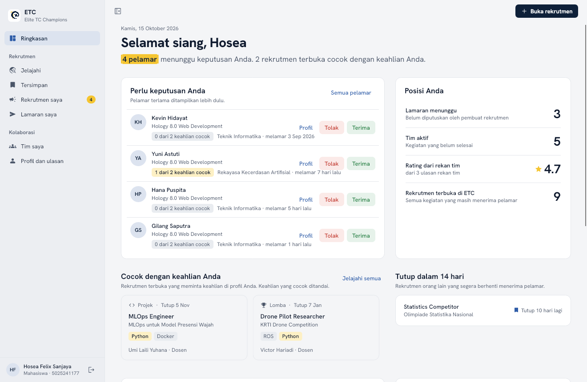

# ETC Desktop

Aplikasi desktop **Elite TC Champions** untuk mencari dan membentuk tim lomba, riset, dan projek bagi mahasiswa dan dosen ITS. Dibuat dengan C# (.NET 8) dan Avalonia UI sebagai tugas ETS Pemrograman Berbasis Kerangka Kerja, Tim 3.

Dokumen kebutuhan lengkap: [docs/PRD.md](docs/PRD.md).



## Menjalankan

Butuh [.NET SDK 8](https://dotnet.microsoft.com/download/dotnet/8.0).

```bash
dotnet run --project ETC.Desktop
```

Saat pertama dijalankan, aplikasi membuat database SQLite dan mengisinya dengan data demo dari `etc-be/migrations/script/seed.sql`.

| Akun demo | NRP / NIP | Kata sandi |
|---|---|---|
| Hosea Felix Sanjaya (mahasiswa, data paling lengkap) | `5025241177` | `etc12345` |
| Muhammad Abid Baihaqi Al Faridzi (mahasiswa) | `5025241133` | `etc12345` |
| Lyonel Oliver Dwiputra (mahasiswa) | `5025241145` | `etc12345` |
| Prof. Ir. Ary Mazharuddin Shiddiqi (dosen) | `19810620 200501 1 003` | `etc12345` |
| Henning Titi Ciptaningtyas (dosen) | `19840708 201012 2 004` | `etc12345` |

Dosen demo adalah 35 dosen Departemen Teknik Informatika ITS, dikelompokkan per rumpun (RPL, KBJ, KCV, AJK, IGS, AP, MI, DTK). Dosen yang NIP-nya belum tersedia memakai ID `DEMO-<rumpun>-<nomor>`. Mahasiswa selain anggota Tim 3 adalah nama fiktif dengan NRP berformat asli: Teknik Informatika `5025`, Rekayasa Perangkat Lunak `5053`, dan Rekayasa Kecerdasan Artifisial `5054`, angkatan 23 sampai 26.

NRP mahasiswa 10 digit. NIP dosen 18 digit dan boleh diketik dengan atau tanpa spasi.

Layar masuk juga punya tombol **Isi akun mahasiswa** dan **Isi akun dosen**.

Lokasi database: `~/.local/share/ETC/etc.db` (Linux), `%LOCALAPPDATA%\ETC\etc.db` (Windows), `~/Library/Application Support/ETC/etc.db` (macOS). Hapus file itu untuk mengulang data demo.

## Fitur

- **Ringkasan**: pelamar yang menunggu keputusan (terima/tolak langsung), posisi Anda, rekomendasi rekrutmen yang cocok dengan keahlian, rekrutmen yang segera tutup, grafik rekrutmen per bulan, keahlian paling dicari, dan status lamaran.
- **Jelajahi**: cari, filter lomba/riset/projek, urutkan, paginasi, detail, simpan, lamar.
- **Rekrutmen saya**: buat, ubah, tutup/buka, hapus; tinjau pelamar beserta kecocokan keahlian, reputasi, dan ulasan.
- **Lamaran saya**: status lamaran, batalkan yang masih menunggu.
- **Tim saya**: anggota tim, kontak WhatsApp, ulasan bintang setelah kegiatan selesai.
- **Profil**: data diri, keahlian, rating dan ulasan yang diterima, mode terang/gelap.

Shortcut: Ctrl+1 sampai Ctrl+6 untuk halaman, Ctrl+N buka rekrutmen, Ctrl+F cari, Ctrl+\\ sidebar, Escape tutup sheet.

## Struktur

```
ETC.Desktop/
  Models/        Entitas (User, Rekrutmen, Pendaftar, Tim, TimParticipant, History, Bookmark)
  Data/          EtcDbContext (EF Core) dan Seeder
  Services/      Logika bisnis dan validasi (Auth, Rekrutmen, Pendaftar, Tim, Dashboard)
  ViewModels/    MVVM dengan CommunityToolkit.Mvvm
  Views/         XAML Avalonia
  Controls/      Glyph (ikon) dan grafik kustom (batang bertumpuk, batang horizontal, meter status)
  Styles/        Token warna terang/gelap, gaya kontrol, ikon
ETC.Tests/       xUnit: test service dan test UI headless
docs/            PRD dan screenshot
```

## Pengujian

```bash
dotnet test
```

41 test: aturan bisnis di service, plus klik-tembus UI dengan Avalonia Headless (masuk, navigasi sidebar, melamar, menerima pelamar, ulasan, hapus dengan konfirmasi, shortcut keyboard, mode gelap).

## Screenshot untuk dokumentasi

Aplikasi bisa merender setiap halaman ke PNG (terang dan gelap) lalu keluar:

```bash
ETC_SNAPSHOT_DIR=docs/screenshots dotnet run --project ETC.Desktop
```

Variabel opsional: `ETC_SNAPSHOT_PAGES` (contoh `auth,Ringkasan,Jelajahi`), `ETC_SNAPSHOT_THEMES` (`light,dark`), `ETC_SNAPSHOT_USER`. `ETC_LOG=1` menampilkan peringatan Avalonia di terminal, `ETC_DB` memakai file database lain.

## Kredit

- Font [Hanken Grotesk](https://fonts.google.com/specimen/Hanken+Grotesk) (SIL Open Font License).
- Ikon [Material Symbols](https://fonts.google.com/icons) (Apache License 2.0).
- Logo dan konsep ETC dari pitch deck Tim 3; skema data dan data demo dari [etc-be](https://github.com/Arthamna/etc-be).
