# Product Requirement Document: ETC Desktop

**Judul studi kasus:** ETC (Elite TC Champions), aplikasi desktop untuk mencari dan membentuk tim lomba, riset, dan projek bagi mahasiswa dan dosen ITS.

| | |
|---|---|
| Mata kuliah | Pemrograman Berbasis Kerangka Kerja (PBKK), tugas ETS |
| Kelompok | Tim 3: Hosea Felix Sanjaya, Muhammad Abid Baihaqi Al Faridzi, Lyonel Oliver Dwiputra |
| Platform | Aplikasi desktop (Windows, Linux, macOS) |
| Bahasa dan kerangka kerja | C# (.NET 8), Avalonia UI 11, Entity Framework Core 8 (SQLite), CommunityToolkit.Mvvm |
| Referensi | Pitch deck *Elite TC Champions*, repositori [etc-be](https://github.com/Arthamna/etc-be) (Go) dan [etc-fe](https://github.com/Arthamna/etc-fe) (Next.js) |
| Status dokumen | Versi 1.1, sesuai implementasi di folder `ETC.Desktop` (menambah halaman Mentor, profil lengkap, dan onboarding di Ringkasan) |

---

## 1. Latar belakang

Survei di Departemen Teknik Informatika ITS (lihat pitch deck, slide 01) menunjukkan kebutuhan mencari teman untuk lomba, riset, dan projek. Masalah yang ditemukan:

1. **Informasi tersebar.** Rekrutmen lomba dan riset diumumkan di grup WhatsApp dan Telegram yang berbeda-beda, sehingga mudah terlewat.
2. **Kurang pembimbing.** Mahasiswa kesulitan menemukan dosen atau mentor yang sedang membuka kesempatan.
3. **Sulit mencari partner lintas jurusan.** Tidak ada tempat untuk mencari orang berdasarkan keahlian tertentu (Backend, UI/UX, dan lain-lain).
4. **Tidak ada penilaian.** Perekrut tidak bisa menilai kualitas calon anggota sebelum menerimanya, karena belum ada fitur rating dan ulasan.

ETC versi web sudah dibuat sebelumnya (etc-be + etc-fe). Dokumen ini menjelaskan **ETC Desktop**: aplikasi desktop dengan antarmuka kaya (rich UI) yang membawa alur yang sama, ditambah dashboard yang membantu pengguna memutuskan tindakan setiap hari.

## 2. Tujuan

Membangun platform terpusat yang menghubungkan mahasiswa dan dosen dalam mencari partner untuk lomba, riset, dan projek. Empat masalah dari pitch deck menjadi tujuan produk:

| Tujuan | Cara ETC Desktop menjawabnya |
|---|---|
| Mengatasi *information gap* | Semua rekrutmen ada di satu daftar yang bisa dicari, difilter, dan disimpan. |
| Mengatasi *department gap* | Pencarian berdasarkan keahlian, bukan jurusan; rekomendasi lintas jurusan di Ringkasan. |
| Mengatasi *skill matching problem* | Setiap rekrutmen mencantumkan keahlian yang dicari; aplikasi menandai keahlian yang cocok, baik di sisi pelamar maupun perekrut. |
| Mengatasi *kurang pembimbing* | Halaman Mentor berisi dosen dan mahasiswa senior beserta keahlian dan prestasinya; tombol "Butuh mentor?" membuka formulir permintaan bimbingan. |
| Mengatasi *trust barrier* | Rating dan ulasan antar-rekan tim setelah kegiatan selesai, ditampilkan saat perekrut meninjau pelamar. |

## 3. Ruang lingkup

**Termasuk (versi ini):**

- Masuk, daftar akun dengan onboarding tiga langkah, dan profil (foto, angkatan, keahlian, pengalaman, tautan LinkedIn/portofolio).
- Daftar mentor dan permintaan bimbingan (kirim, batalkan, terima/tolak oleh mentor).
- Membuat, mengubah, menutup/membuka kembali, dan menghapus rekrutmen.
- Jelajahi rekrutmen: pencarian teks, filter jenis kegiatan, urutan, paginasi, dan detail.
- Simpan (bookmark) rekrutmen.
- Melamar dengan tautan CV, portofolio, dan alasan; membatalkan lamaran yang masih menunggu.
- Meninjau pelamar (keahlian, reputasi, ulasan), lalu menerima atau menolak.
- Tim otomatis terbentuk dari pelamar yang diterima; daftar anggota dan kontak.
- Ulasan dan rating antar-anggota setelah kegiatan selesai.
- Dashboard (Ringkasan) dengan kartu onboarding "Lengkapi profil" dan grafik interaktif.
- Mode terang dan gelap, shortcut keyboard.

**Tidak termasuk (versi berikutnya):**

- Sinkronisasi ke server etc-be. Versi ini menyimpan data lokal di SQLite.
- Unggah berkas CV ke Google Drive (etc-be memakai Drive; versi desktop memakai tautan).
- Notifikasi push dan chat di dalam aplikasi. Kontak dilakukan lewat WhatsApp.
- Peran admin.

## 4. Pengguna dan aktor

Aktor dan aksi diambil dari pitch deck (slide 06).

| Aktor | Kebutuhan utama | Aksi di aplikasi |
|---|---|---|
| **Mahasiswa** | Menemukan tim lomba, posisi asisten riset, atau projek yang sesuai keahlian; juga merekrut teman untuk lomba. | Mendaftar rekrutmen, mencari rekrutmen, membuat rekrutmen, melihat riwayat pendaftar rekrutmen, memberi ulasan rekan tim. |
| **Dosen** | Merekrut asisten riset atau anggota projek yang bisa dipercaya. | Membuat rekrutmen, melihat riwayat pendaftar rekrutmen, mencari rekrutmen, memberi ulasan anggota tim, menjawab permintaan bimbingan. |
| **Mentor** | Dosen atau mahasiswa senior yang mau membimbing tim lomba, riset, atau projek. | Mengaktifkan mode mentor di Profil, lalu menerima atau menolak permintaan bimbingan. |

Kedua aktor memakai fitur yang sama; perbedaannya ada pada identitas (NRP untuk mahasiswa, NIP untuk dosen) dan konteks pemakaian.

## 5. Proses bisnis

Proses bisnis dari pitch deck (slide 03): **pengguna membutuhkan tim → rekrutmen (skill matching) → tim terbentuk.**

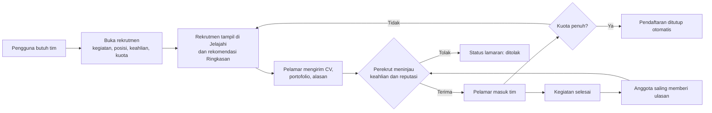

Ulasan mengalir kembali ke langkah peninjauan: perekrut berikutnya melihat rating dan ulasan pelamar sebelum memutuskan.

## 6. Kebutuhan fungsional

Prioritas: **W** = wajib untuk ETS, **P** = penting. Kolom terakhir menunjukkan di mana kebutuhan itu diimplementasikan.

### 6.1 Akun dan profil

| ID | Kebutuhan | Prioritas | Implementasi |
|---|---|---|---|
| F-01 | Pengguna masuk dengan NRP/NIP dan kata sandi. Pesan salah tidak membedakan "akun tidak ada" dan "kata sandi salah". | W | `AuthService.LoginAsync` |
| F-02 | Daftar akun dalam tiga langkah: (1) peran, nama, NRP/NIP; (2) departemen, nomor WhatsApp; (3) keahlian, kata sandi. Setiap langkah divalidasi sebelum lanjut. | W | `AuthViewModel`, `AuthView` |
| F-03 | NRP/NIP unik. NRP 10 digit (format 5025241XXX); NIP 18 digit, disimpan dengan pengelompokan baku (19810620 200501 1 003) sehingga bisa diketik dengan atau tanpa spasi. Kata sandi minimal 8 karakter dan disimpan sebagai hash bcrypt. | W | `AuthService.RegisterAsync`, `NormalizeNoPengenal` |
| F-04 | Pengguna mengubah nama, departemen, nomor WhatsApp, bio, keahlian, angkatan (mahasiswa), pengalaman dan prestasi (maksimal 1000 karakter, satu per baris), serta tautan LinkedIn dan portofolio (opsional, harus URL http/https). Angkatan diisi otomatis dari NRP saat mendaftar (5025**24**1177 → 2024). | W | `ProfileViewModel`, `AuthService.ValidateProfile` |
| F-07 | Pengguna mengganti atau menghapus foto profil (JPG, PNG, WebP, maksimal 5 MB). Foto disalin ke folder data aplikasi dan dipakai di sidebar, profil, dan kartu mentor; tanpa foto, inisial nama ditampilkan. | P | `AuthService.SetFotoAsync`, `Controls/Avatar` |
| F-05 | Profil menampilkan rata-rata rating dan daftar ulasan dari rekan tim. | P | `ProfileView` |
| F-06 | Pengguna memilih mode tampilan: ikuti sistem, terang, atau gelap. | P | `AppSettings` |

### 6.2 Rekrutmen

| ID | Kebutuhan | Prioritas | Implementasi |
|---|---|---|---|
| F-10 | Membuat rekrutmen: jenis kegiatan (lomba/riset/projek), nama kegiatan, posisi, deskripsi, kriteria, keahlian, kuota, batas pendaftaran, tanggal mulai dan selesai, fee opsional, link detail opsional (guidebook atau halaman resmi, harus URL http/https), kontak. | W | `RekrutmenFormViewModel`, `RekrutmenService.CreateAsync` |
| F-11 | Validasi: batas pendaftaran tidak di masa lalu, mulai ≥ batas, selesai ≥ mulai, kuota 1 sampai 20, minimal satu keahlian. | W | `RekrutmenService.Validate` |
| F-12 | Pembuat rekrutmen otomatis menjadi ketua tim (anggota ke-1), seperti di etc-be. | W | `RekrutmenService.CreateAsync` |
| F-13 | Pembuat bisa mengubah, menutup, membuka kembali, dan menghapus rekrutmennya. Hapus meminta konfirmasi. Kuota tidak bisa diturunkan di bawah jumlah anggota yang sudah diterima. | W | `MyRekrutmenViewModel` |
| F-14 | Jelajahi: cari berdasarkan posisi, nama kegiatan, keahlian, atau nama pembuat; filter jenis kegiatan; urutkan (terbaru, tenggat terdekat, sisa kuota terbanyak); tampilkan hanya yang masih dibuka; paginasi 12 per halaman. | W | `ExploreViewModel`, `RekrutmenService.SearchAsync` |
| F-15 | Detail rekrutmen: batas pendaftaran, periode, kuota terisi, fee, deskripsi, kriteria, keahlian yang cocok dengan profil, reputasi pembuat, dan tombol Info lengkap bila ada link detail. | W | `RekrutmenDetailView` |
| F-16 | Simpan dan lepas simpan rekrutmen; halaman Tersimpan diurutkan dari tenggat terdekat. | W | `RekrutmenService.ToggleBookmarkAsync` |

### 6.3 Lamaran dan tim

| ID | Kebutuhan | Prioritas | Implementasi |
|---|---|---|---|
| F-20 | Melamar dengan tautan CV dan portofolio (wajib, harus URL http/https) dan alasan (opsional, maksimal 500 karakter). | W | `ApplySheetViewModel`, `PendaftarService.ApplyAsync` |
| F-21 | Tidak bisa melamar rekrutmen sendiri, rekrutmen yang sudah ditutup, atau melamar dua kali. | W | `PendaftarService.ApplyAsync` |
| F-22 | Lamaran saya: daftar lamaran dengan status (menunggu, diterima, ditolak) yang ditandai ikon dan label; lamaran yang menunggu bisa dibatalkan setelah konfirmasi. | W | `MyApplicationsViewModel` |
| F-23 | Perekrut melihat pelamar beserta keahlian yang cocok, reputasi (rating, jumlah kegiatan selesai), tiga ulasan terbaru, alasan, tautan CV/portofolio, dan kontak WhatsApp. | W | `MyRekrutmenView` |
| F-24 | Perekrut menerima atau menolak pelamar. Pelamar yang diterima langsung masuk tim. Saat kuota penuh, pendaftaran ditutup otomatis dan pelamar berikutnya tidak bisa diterima. | W | `PendaftarService.DecideAsync` |
| F-25 | Tim saya: daftar tim beserta status kegiatan (belum mulai, berjalan, selesai), anggota, peran, keahlian, dan tombol WhatsApp. | W | `TeamsViewModel` |
| F-27 | Formulir lamaran mengisi tautan portofolio dari profil bila sudah ada. | P | `ApplySheetViewModel` |
| F-26 | Setelah kegiatan selesai, anggota memberi rating 1 sampai 5 dan ulasan (minimal 10 karakter) ke rekan satu tim, satu kali per rekan per tim. | P | `TimService.RateAsync` |

### 6.4 Mentor

| ID | Kebutuhan | Prioritas | Implementasi |
|---|---|---|---|
| F-30 | Halaman Mentor menampilkan kartu mentor: foto (atau inisial), nama, dosen/mahasiswa dan angkatan, rating, jumlah bimbingan diterima, keahlian, pengalaman dan prestasi, serta tautan LinkedIn/portofolio. Dosen ditampilkan lebih dulu. | W | `MentorView`, `MentorService.ListAsync` |
| F-31 | Cari mentor berdasarkan nama, keahlian, atau isi pengalaman; filter Semua/Dosen/Mahasiswa. | W | `MentorViewModel` |
| F-32 | Tombol "Butuh mentor?" membuka formulir: pilih mentor, jenis kegiatan, topik (5 sampai 120 karakter), dan kebutuhan (20 sampai 800 karakter). Tombol "Minta bimbingan" di kartu membuka formulir yang sama dengan mentor terpilih. | W | `MentorRequestSheetViewModel`, `MentorService.Validate` |
| F-33 | Tidak bisa meminta bimbingan ke diri sendiri, ke pengguna yang bukan mentor, atau mengirim permintaan kedua ke mentor yang sama selama yang pertama belum dijawab. | W | `MentorService.RequestAsync` |
| F-34 | Permintaan saya: status (menunggu, diterima, ditolak); permintaan yang menunggu bisa dibatalkan lewat konfirmasi; bila diterima, tombol Hubungi membuka WhatsApp mentor. | W | `MentorViewModel` |
| F-35 | Pengguna menjadi mentor dengan menyalakan "Jadi mentor" di Profil; syaratnya minimal satu keahlian dan pengalaman terisi. Mentor mendapat tab Permintaan masuk untuk menerima atau menolak, dan badge di sidebar untuk permintaan yang menunggu. | W | `AuthService.ValidateProfile`, `MentorService.DecideAsync` |

### 6.5 Dashboard (Ringkasan)

Dashboard adalah halaman pertama setelah masuk. Pertanyaan yang dijawabnya: **"Apa yang perlu saya putuskan atau lamar hari ini?"** Karena itu urutannya adalah keputusan dulu, baru tren.

| ID | Bagian | Pertanyaan yang dijawab | Data |
|---|---|---|---|
| D-00 | Lengkapi profil Anda (onboarding) | Apa yang kurang dari profil saya? | Daftar langkah: foto, angkatan (mahasiswa), minimal tiga keahlian, pengalaman, tautan LinkedIn atau portofolio, beserta progres. Kartu hilang setelah semua langkah selesai. |
| D-01 | Kalimat ringkas di bawah sapaan | Ada yang menunggu saya? | Jumlah pelamar menunggu (diberi penanda emas) dan jumlah rekomendasi. |
| D-02 | Perlu keputusan Anda | Siapa yang menunggu keputusan, dan seberapa cocok? | Lima pelamar terlama, kecocokan keahlian, tombol Terima/Tolak langsung. |
| D-03 | Posisi Anda | Bagaimana posisi saya saat ini? | Lamaran menunggu, tim aktif, rating dari rekan tim, rekrutmen terbuka. Setiap baris membuka halaman terkait. |
| D-04 | Cocok dengan keahlian Anda | Rekrutmen apa yang sebaiknya saya lamar? | Rekrutmen terbuka yang meminta keahlian di profil, belum dilamar, diurutkan dari kecocokan lalu tenggat. |
| D-05 | Tutup dalam 14 hari | Apa yang segera berakhir? | Rekrutmen orang lain dengan batas pendaftaran ≤ 14 hari; rekrutmen tersimpan ditandai. |
| D-06 | Grafik batang bertumpuk | Berapa rekrutmen baru tiap bulan, dan untuk kegiatan apa? | 12 bulan terakhir, dipisah lomba/riset/projek. Tooltip saat hover, tombol Tabel untuk melihat angka. |
| D-07 | Grafik batang horizontal | Keahlian apa yang paling dicari, dan apakah saya punya? | Delapan keahlian teratas di rekrutmen terbuka; keahlian yang ada di profil diberi tanda centang. |
| D-08 | Meter status | Bagaimana nasib lamaran? | Proporsi diterima/menunggu/ditolak untuk pelamar di rekrutmen saya dan lamaran yang saya kirim. |

Semua angka dihitung dari database saat halaman dibuka (`DashboardService`). Tidak ada angka tetap atau contoh.

## 7. Kebutuhan non-fungsional

| ID | Kebutuhan | Cara memenuhinya |
|---|---|---|
| N-01 | Keamanan kata sandi | Hash bcrypt (work factor 10); kata sandi tidak pernah disimpan atau ditampilkan. |
| N-02 | Otorisasi | Hanya pembuat yang bisa mengubah atau menghapus rekrutmen dan memutuskan pelamar. Ulasan hanya untuk rekan satu tim. Diperiksa di layer service, bukan hanya di UI. |
| N-03 | Integritas data | Indeks unik: NRP/NIP, satu lamaran per orang per rekrutmen, satu bookmark per orang per rekrutmen, satu ulasan per pasangan per tim. Hapus rekrutmen ikut menghapus lamaran, tim, dan ulasan terkait. |
| N-04 | Bekerja tanpa internet | Data disimpan di SQLite lokal (`%LOCALAPPDATA%/ETC/etc.db` atau `~/.local/share/ETC/etc.db`). Internet hanya dipakai untuk membuka tautan. |
| N-05 | Responsif | Semua akses database berjalan asinkron; UI tetap bisa dipakai saat data dimuat. Pencarian memakai jeda 250 ms supaya tidak memuat ulang di setiap ketikan. |
| N-06 | Aksesibilitas | Kontras teks memenuhi WCAG AA (dihitung, lihat bagian 8.2). Status tidak pernah hanya ditandai warna. Semua kontrol bisa dipakai dengan keyboard dan punya cincin fokus terlihat. Tombol ikon punya nama untuk pembaca layar. Grafik punya ringkasan teks dan tampilan tabel. |
| N-07 | Keadaan UI lengkap | Setiap daftar punya keadaan memuat, kosong (dengan alasan dan langkah berikutnya), dan galat (dengan tombol muat ulang). |
| N-08 | Lintas platform | Avalonia berjalan di Windows, Linux, dan macOS dari kode yang sama. |
| N-09 | Dapat diuji | Logika bisnis ada di service yang bisa diuji tanpa UI; UI diuji dengan Avalonia Headless. |

## 8. Desain antarmuka

### 8.1 Arah desain

Desain mengikuti prinsip Apple Human Interface Guidelines untuk aplikasi desktop (macOS):

- **Sidebar** di kiri untuk navigasi tingkat atas, dengan dua grup (Rekrutmen, Kolaborasi) dan maksimal dua tingkat hierarki. Sidebar bisa disembunyikan (Ctrl+\\).
- **Split view** untuk alur daftar ke detail: Jelajahi (daftar | detail) dan Rekrutmen saya (rekrutmen | pelamar | profil pelamar).
- **Sheet** untuk tugas pendek (lamar, buat rekrutmen, ulasan, konfirmasi). Hanya satu sheet sekaligus, bisa ditutup dengan Escape atau klik di luar.
- **Umpan balik di dalam antarmuka**, berupa toast singkat, bukan dialog. Dialog konfirmasi hanya untuk aksi yang tidak bisa dibatalkan (hapus rekrutmen, batalkan lamaran), dan tombol default-nya adalah Batal.
- Label tombol menyebut hasilnya: "Kirim lamaran", "Terima ke tim", "Buka rekrutmen", bukan "Submit" atau "OK".

### 8.2 Warna

Palet diambil dari logo ETC (navy dan emas), bukan dari palet bawaan template:

| Token | Terang | Gelap | Peran |
|---|---|---|---|
| Primary | `#0E2039` navy, teks putih (16.4:1) | `#F5C531` emas, teks navy (10.1:1) | Satu aksi utama per layar. Peran navy dan emas dibalik di mode gelap. |
| Marker | `#F5C531` emas | `#F5C531` emas | Penanda angka yang perlu tindakan (identitas visual): sorotan di kalimat ringkas, badge jumlah pelamar menunggu, keahlian yang cocok. |
| Text primary | `#0F1A2E` (17.4:1 pada putih) | `#EEF1F6` (16.0:1) | Teks utama. |
| Text secondary | `#4A5568` (6.9:1) | `#B3BAC7` (8.3:1) | Teks pendukung. |
| Text tertiary | `#5F6879` (4.8:1 pada sidebar) | `#98A0AE` (≥ 4.7:1, termasuk saat hover) | Keterangan kecil. |
| Accent | `#2F5DA8` | `#8FB0EA` | Tautan, cincin fokus, ikon sidebar terpilih. |
| Status | hijau `#1F7A3D`, merah `#C0362C`, abu-abu | hijau `#5BC27A`, merah `#F07167`, abu-abu | Diterima, ditolak, menunggu. Selalu disertai ikon dan label. |

Warna grafik (lomba `#C9930A`, riset `#1C9A86`, projek `#2F5DA8`, dengan langkah gelap tersendiri) divalidasi dengan validator palet dataviz untuk semua pasangan di kedua mode: jarak buta warna terburuk ΔE 12.2 (terang) dan 11.1 (gelap), di atas target 8.

### 8.3 Tipografi

Satu keluarga huruf, **Hanken Grotesk**, disertakan di dalam aplikasi. Alasannya: proporsinya dekat dengan SF Pro dan aperturnya terbuka sehingga tetap terbaca di 13 px (ukuran body desktop menurut HIG). Font ini juga bukan huruf bawaan yang sering dipakai template. Hierarki dibawa oleh ukuran dan ketebalan: display 30/ExtraBold, judul halaman 24/ExtraBold, judul bagian 17/Bold, body 13/Regular, keterangan 12.

### 8.4 Ikon

Material Symbols Rounded versi isi (*filled*), karena bentuknya dekat dengan SF Symbols isi yang dipakai di sidebar macOS. Ikon digambar oleh kontrol `Glyph` pada kotak aslinya, sehingga ukurannya konsisten.

### 8.5 Shortcut keyboard

| Shortcut | Aksi |
|---|---|
| Ctrl+1 sampai Ctrl+7 | Ringkasan, Jelajahi, Tersimpan, Rekrutmen saya, Lamaran saya, Tim saya, Mentor |
| Ctrl+, | Profil |
| Ctrl+N | Buka rekrutmen baru |
| Ctrl+F | Cari (di Jelajahi dan Tersimpan) |
| Ctrl+\\ | Tampilkan atau sembunyikan sidebar |
| Escape | Tutup sheet |
| Enter | Kirim formulir masuk dan daftar |

### 8.6 Tampilan aplikasi

| Ringkasan (terang) | Ringkasan (gelap) |
|---|---|
|  | 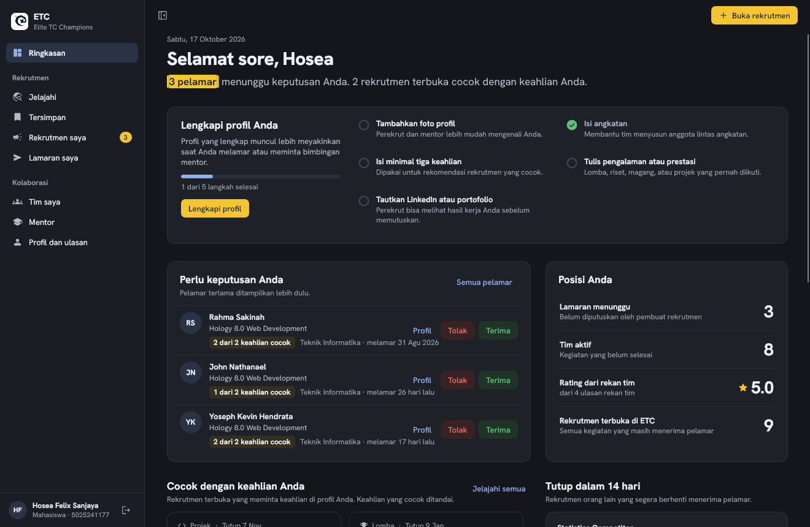 |
| 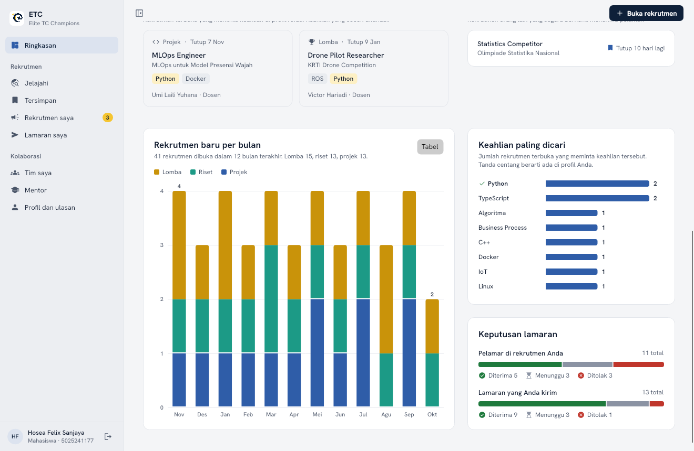 | 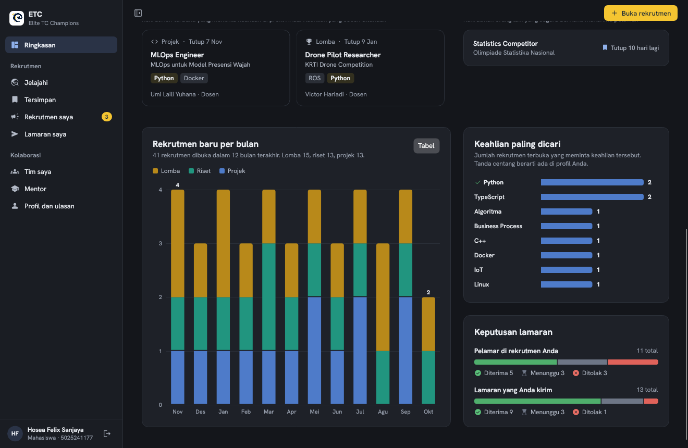 |

| Jelajahi | Rekrutmen saya |
|---|---|
| 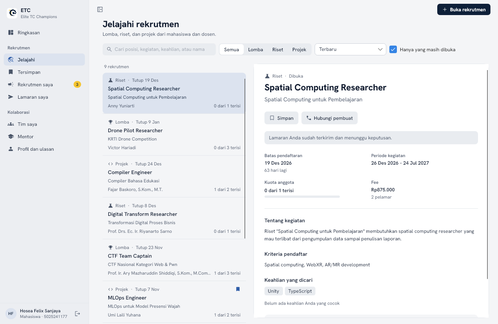 | 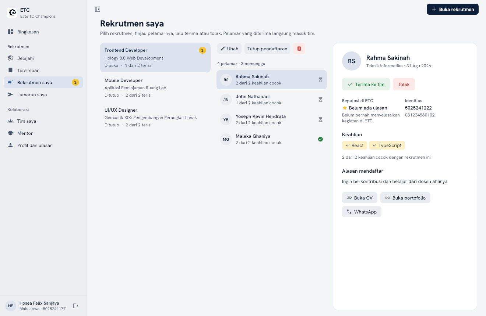 |

| Masuk | Buka rekrutmen |
|---|---|
| 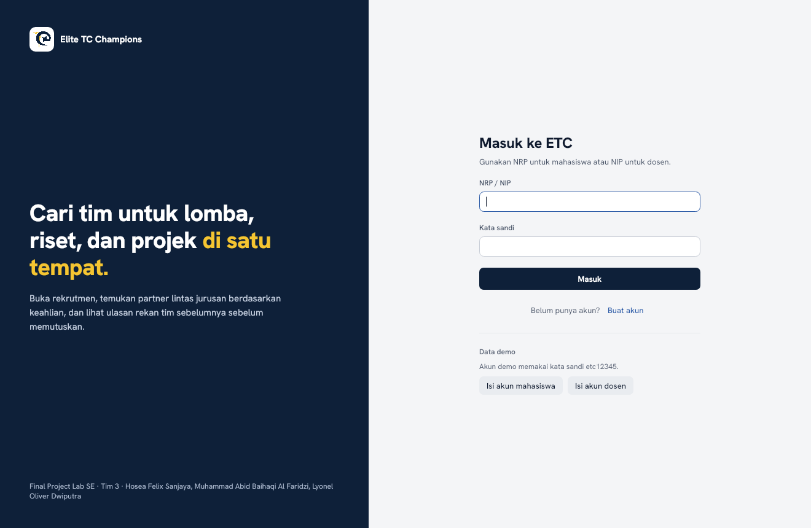 | 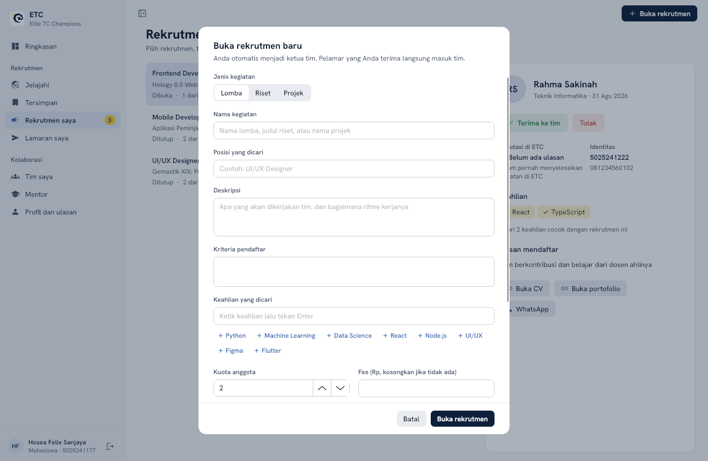 |

| Mentor | Mentor (gelap) |
|---|---|
| 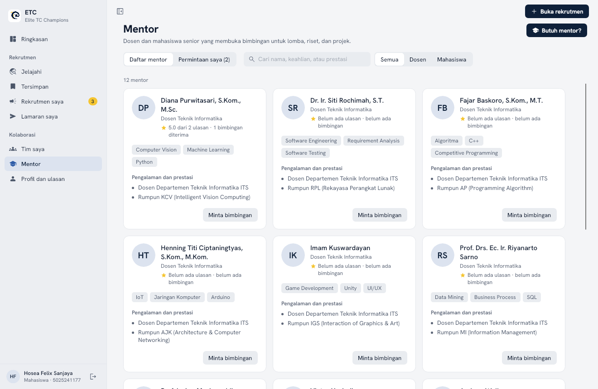 | 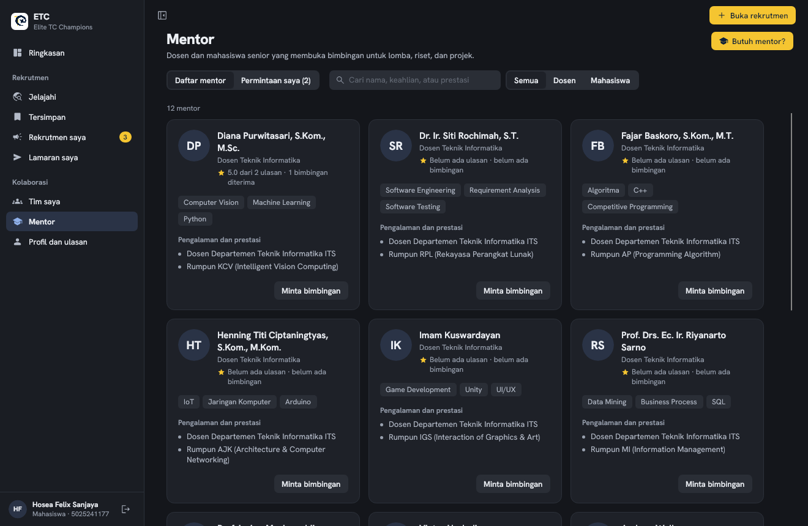 |

| Lamaran saya | Tim saya (gelap) | Profil (gelap) |
|---|---|---|
| 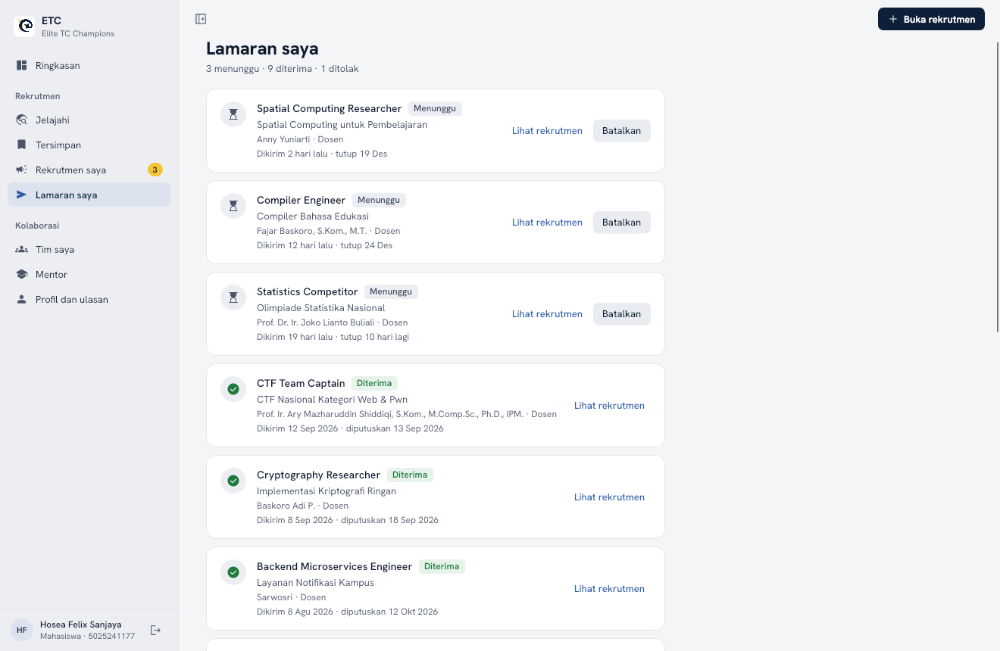 | 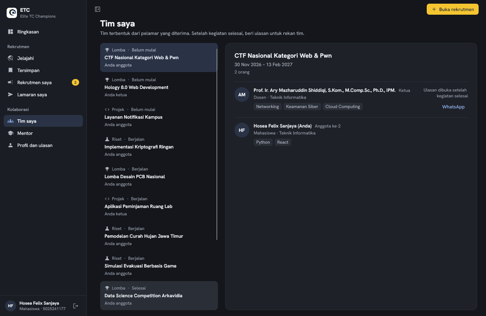 | 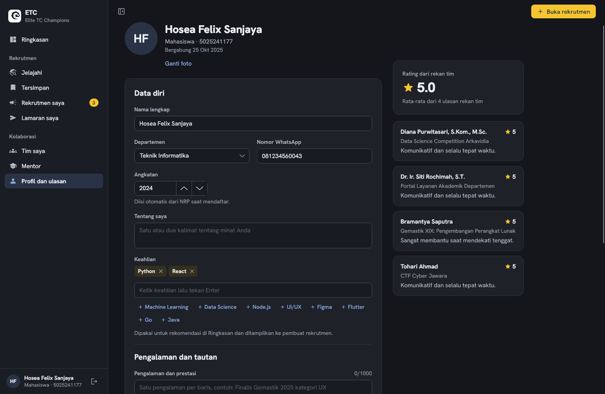 |

## 9. Arsitektur teknis

### 9.1 Lapisan

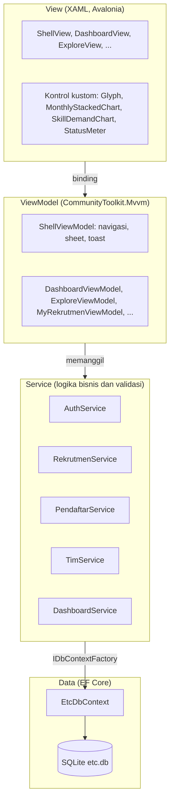

- **MVVM.** View hanya berisi tata letak dan binding. Semua keadaan dan perintah ada di ViewModel (`[ObservableProperty]`, `[RelayCommand]`).
- **Dependency injection.** Service didaftarkan di `App.BuildServices` (Microsoft.Extensions.DependencyInjection). ViewModel dibuat dengan `ActivatorUtilities`, sehingga dependensinya terisi otomatis.
- **Service layer** setara dengan `internal/services` + `internal/repositories` di etc-be. Setiap operasi memakai `DbContext` berumur pendek dari `IDbContextFactory`.
- **ViewLocator** memetakan `XxxViewModel` ke `XxxView` berdasarkan nama.

### 9.2 Model data

Skema mengikuti `etc-be/internal/models` dengan tambahan kolom yang dibutuhkan versi desktop (ditandai *).

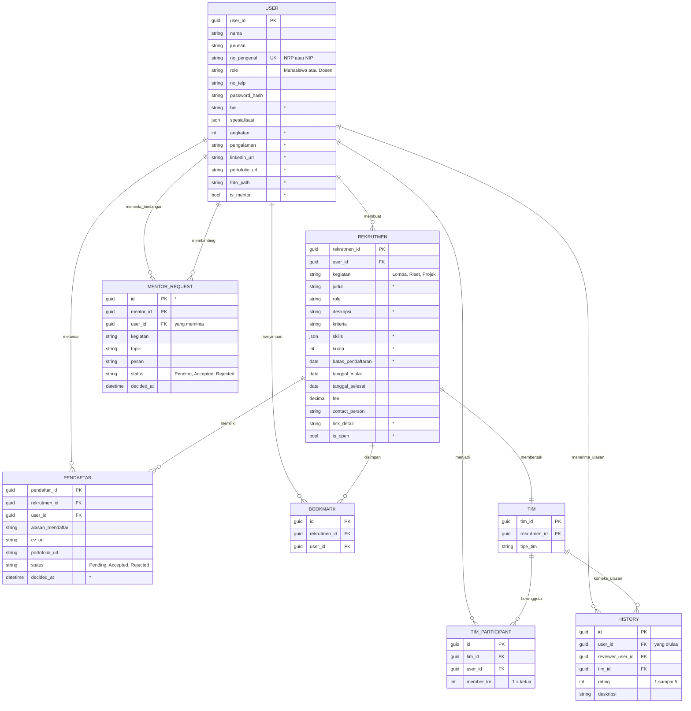

Database dari versi sebelumnya tidak perlu dihapus: saat aplikasi dibuka, `SchemaUpgrade` menambahkan kolom dan tabel baru, lalu `Seeder` mengisi data mentor demo bila akun demo ada.

### 9.3 Pemetaan ke etc-be

| Endpoint etc-be (Bruno docs) | Padanan di ETC Desktop |
|---|---|
| `User/Auth/Login`, `Register User`, `Get Me`, `Update User` | `AuthService` |
| `Rekrutmen/Find/Get All`, `GetType`, `GetRole`, `GetId` | `RekrutmenService.SearchAsync`, `GetDetailAsync` |
| `Rekrutmen/Make/Create`, `Update`, `Delete`, `Get Mine` | `RekrutmenService.CreateAsync`, `UpdateAsync`, `DeleteAsync`, `MineAsync` |
| `Rekrutmen/Make/Check Applicants`, `Applicant Profile`, `Accept/Reject Applicant` | `PendaftarService.ApplicantsAsync`, `ReviewsForAsync`, `DecideAsync` |
| `Rekrutmen/Apply/Apply Rekrutmen`, `Check Status` | `PendaftarService.ApplyAsync`, `MyApplicationsAsync` |
| `Rekrutmen/Tim/Members`, `Rating Member` | `TimService.MyTeamsAsync`, `RateAsync` |
| `User/Bookmark/*` | `RekrutmenService.ToggleBookmarkAsync`, `BookmarkedAsync` |

### 9.4 Data demo

Saat pertama dijalankan, aplikasi mengisi database dengan 35 dosen Departemen Teknik Informatika ITS dan 30 mahasiswa. Rekrutmen (kriteria dan posisi dari `etc-be/migrations/script/seed.sql`) dibuat oleh dosen dari rumpun yang sesuai topiknya, misalnya computer vision oleh rumpun KCV dan CTF oleh rumpun KBJ.

- **Dosen:** dikelompokkan per rumpun (RPL, KBJ, KCV, AJK, IGS, AP, MI, DTK); rumpun tampil di bio. NIP asli dipakai bila tersedia (misalnya Prof. Ir. Ary Mazharuddin Shiddiqi, 19810620 200501 1 003). Dosen lain memakai ID `DEMO-<rumpun>-<nomor>` agar tidak menyerupai NIP asli.
- **Mahasiswa:** tiga anggota Tim 3 memakai NRP asli (Hosea Felix Sanjaya 5025241177, Muhammad Abid Baihaqi Al Faridzi 5025241133, Lyonel Oliver Dwiputra 5025241145). Akun Hosea memiliki riwayat paling lengkap. Mahasiswa lain adalah 81 mahasiswa Teknik Informatika (5025, angkatan 23 sampai 26) dengan nama dan NRP asli dari daftar mahasiswa departemen. Lamaran, keputusan, ulasan, dan prestasi mentor atas nama mereka adalah data karangan untuk demo.
- **Mentor:** satu dosen per rumpun (dosen dengan NIP asli didahulukan, sehingga akun demo Prof. Ary dan Henning menjadi mentor). Keahliannya adalah bidang rumpun dan pengalamannya hanya keterangan rumpun; prestasi dosen tidak dikarang. Empat mahasiswa fiktif angkatan 2023 menjadi mentor dengan prestasi karangan. Akun Hosea punya dua permintaan bimbingan (diterima dan menunggu), dan Prof. Ary punya dua permintaan masuk yang menunggu.

## 10. Kriteria penerimaan dan pengujian

Pengujian otomatis ada di proyek `ETC.Tests` (xUnit). Jalankan dengan `dotnet test`. Hasil saat dokumen ini ditulis: **51 dari 51 lulus**.

**Test service** (logika bisnis, database SQLite sementara per test):

| Kriteria | Test |
|---|---|
| Kata sandi salah ditolak; daftar langsung masuk; NRP ganda ditolak; format NRP, NIP, dan WhatsApp divalidasi; NIP bisa diketik tanpa spasi; gelar tidak masuk sapaan | `AuthTests` |
| Validasi urutan tanggal, kuota, keahlian; pembuat jadi ketua tim; pencarian dan filter; bookmark; hanya pemilik bisa menghapus | `RekrutmenTests` |
| Alur lamar → terima → masuk tim → kuota penuh → pendaftaran tertutup; tidak bisa melamar sendiri, tertutup, atau dua kali; tautan CV wajib URL; hanya lamaran menunggu yang bisa dibatalkan | `LamaranTests` |
| Ulasan hanya untuk rekan tim dan sekali; angka dashboard sama dengan hitungan langsung di database | `TimDanDashboardTests` |
| Angkatan dari NRP; validasi tautan profil dan angkatan; syarat mode mentor; foto profil disalin dan formatnya dicek; link detail rekrutmen; daftar dan pencarian mentor; alur minta bimbingan → mentor menerima; database versi lama ditingkatkan tanpa kehilangan data | `ProfilDanMentorTests` |

**Test UI headless** (klik dan tombol keyboard sungguhan pada jendela aplikasi):

| Kriteria | Test |
|---|---|
| Masuk kosong menampilkan pesan; tombol akun demo mengisi formulir dan masuk | `Login_salah_menampilkan_pesan_lalu_akun_demo_berhasil` |
| Onboarding memvalidasi langkah 1 dan bisa kembali ke layar masuk | `Onboarding_tiga_langkah_memvalidasi_tiap_langkah` |
| Kedelapan item sidebar membuka halamannya | `Setiap_item_sidebar_membuka_halamannya` |
| Ctrl+N membuka formulir, formulir kosong ditolak, Escape menutup | `Ctrl_N_membuka_formulir_dan_Escape_menutupnya` |
| Membuat rekrutmen lengkap lalu langsung terpilih di Rekrutmen saya | `Membuat_rekrutmen_lengkap_lalu_tampil_di_Rekrutmen_saya` |
| Melamar dari Jelajahi (termasuk validasi tautan) sampai muncul di Lamaran saya | `Melamar_dari_Jelajahi_sampai_muncul_di_Lamaran_saya` |
| Terima pelamar dari Ringkasan, badge sidebar berkurang | `Menerima_pelamar_dari_Ringkasan_mengurangi_badge` |
| Simpan rekrutmen lalu muncul di Tersimpan | `Simpan_rekrutmen_lalu_muncul_di_Tersimpan` |
| Filter kegiatan, keadaan kosong, dan tombol hapus filter | `Filter_kegiatan_dan_hapus_filter_di_Jelajahi` |
| Beri ulasan bintang 4 ke rekan tim | `Memberi_ulasan_rekan_tim_yang_kegiatannya_selesai` |
| Batalkan lamaran lewat konfirmasi | `Membatalkan_lamaran_lewat_konfirmasi` |
| Hapus rekrutmen meminta konfirmasi, Batal tidak menghapus | `Hapus_rekrutmen_meminta_konfirmasi_dan_Batal_tidak_menghapus` |
| Simpan profil memvalidasi nomor, lalu keluar kembali ke layar masuk | `Simpan_profil_memvalidasi_nomor_lalu_keluar` |
| Mode gelap dari Profil mengubah tema | `Mode_gelap_dari_Profil_mengubah_tema` |
| Kartu onboarding tampil di Ringkasan dan tombolnya membuka Profil | `Ringkasan_menampilkan_langkah_onboarding_profil` |
| "Butuh mentor?" membuka formulir, memvalidasi pilihan mentor, lalu permintaan muncul di Permintaan saya | `Butuh_mentor_membuka_form_dan_mengirim_permintaan` |

Dua bug yang ditemukan oleh test ini dan sudah diperbaiki: shortcut keyboard tidak aktif tepat setelah masuk (fokus hilang bersama layar masuk), dan tombol "Hapus semua filter" tertutup oleh daftar kosong yang transparan.

## 11. Rencana pengembangan

Tahapan mengikuti pitch deck (slide 04).

| Tahap | Kegiatan | Hasil |
|---|---|---|
| Requirements | Menyesuaikan kebutuhan dengan sistem web yang sudah ada dan hasil survei | Dokumen ini, bagian 1 sampai 7 |
| Design | Rancangan tampilan, fitur, dan alur aplikasi | Bagian 8, token warna dan tipografi |
| Development | Membangun aplikasi dari desain | Folder `ETC.Desktop` |
| Testing | Memastikan aplikasi berjalan sesuai desain | Folder `ETC.Tests`, bagian 10 |
| Deployment | Membuat paket aplikasi untuk Windows dan Linux | `dotnet publish -c Release -r win-x64` / `linux-x64` |
| Review | Survei ke anggota RT HTMC dan mahasiswa lain | Masukan untuk versi berikutnya |

## 12. Risiko dan mitigasi

| Risiko | Dampak | Mitigasi |
|---|---|---|
| Data hanya lokal, tidak terbagi antar-pengguna | Versi desktop belum bisa dipakai bersama seperti versi web | Service layer sudah dipisah; versi berikutnya mengganti implementasi service dengan klien HTTP ke etc-be tanpa mengubah ViewModel dan View. |
| Tautan CV tidak bisa dibuka perekrut | Lamaran sulit dinilai | Petunjuk di formulir lamaran agar tautan dibuka untuk siapa saja yang memiliki link; validasi format URL. |
| Ulasan tidak jujur | Reputasi menyesatkan | Ulasan hanya dari rekan satu tim, hanya setelah kegiatan selesai, dan satu kali per pasangan. |
| Pengguna lupa kata sandi | Tidak bisa masuk | Belum ada di versi ini; direncanakan bersama sinkronisasi server. |

## 13. Ukuran keberhasilan (target untuk tahap Review)

Target ini belum diukur; akan dinilai pada survei tahap Review.

- Pengguna baru bisa menyelesaikan daftar akun sampai melamar rekrutmen pertama tanpa bantuan.
- Perekrut bisa memutuskan satu pelamar dari halaman Ringkasan dalam satu klik setelah meninjau profilnya.
- Responden survei menilai informasi rekrutmen lebih mudah ditemukan dibanding grup WhatsApp/Telegram.
